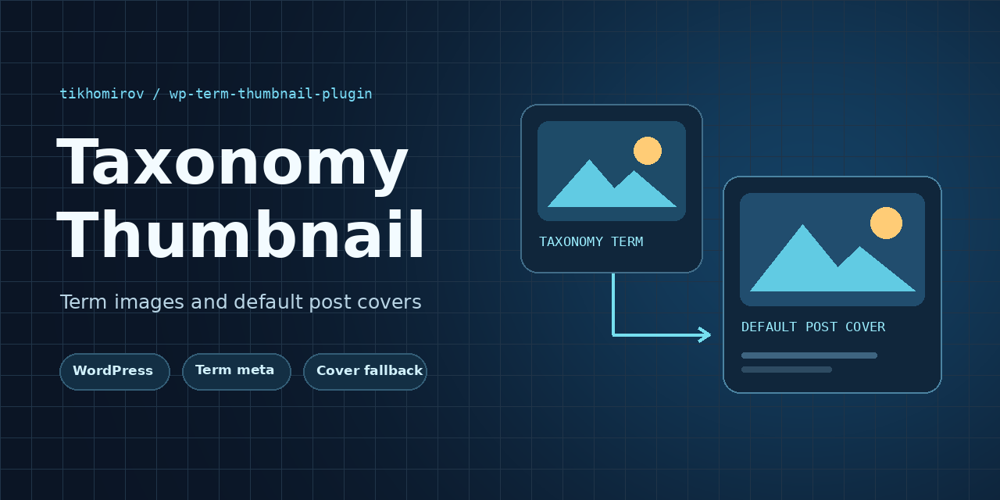

# Taxonomy Thumbnail

[English version](README.md)

Назначайте терминам таксономий WordPress собственные миниатюры и отдельно — обложки по умолчанию для записей, которые относятся к этим терминам.

## Требования

- WordPress 6.3+
- PHP 8.0+

## Установка

1. Скачайте плагин из [GitHub Releases](https://github.com/tikhomirov/wp-term-thumbnail-plugin/releases). Если последний релиз отстаёт от описанного здесь кода, скачайте ZIP ветки `master`.
2. Распакуйте плагин в `wp-content/plugins/wp-term-thumbnail-plugin` без суффикса `-master`. Если сайт ведётся в Git, можно подключить репозиторий по тому же пути как submodule. Оставьте только одну копию плагина.
3. Активируйте **Taxonomy Thumbnail** в разделе **Плагины**.

## Использование

1. Выберите таксономии в разделе **Настройки → Медиафайлы → Настройки миниатюр терминов**. В Multisite используйте раздел **Управление сетью → Настройки → Term Thumbnail**. По умолчанию выбраны таксономии, доступные для публичных запросов.
2. Откройте редактирование термина выбранной таксономии. Задайте **Taxonomy thumbnail** для изображения самого термина и **Default Post Taxonomy Thumbnail** для обложки, которую могут наследовать записи. Эти поля независимы.

| Ключ метаполя термина | Значение |
| --- | --- |
| `term_image_id` | ID вложения с миниатюрой самого термина |
| `default_cover` | ID вложения с обложкой записи по умолчанию |

## PHP API

Вызывайте функции после загрузки плагина:

```php
$image_id = get_term_thumbnail_id($term_id);
$image_url = $image_id ? wp_get_attachment_image_url($image_id, 'thumbnail') : false;
$cover_id = get_post_default_cover_id($post_id, ['category', 'my_taxonomy']);

// На странице архива термина: вывести миниатюру текущего термина.
the_term_thumbnail(['width' => 100, 'height' => 100]);
```

- `get_term_thumbnail_id($term_id)` возвращает сохранённый ID или `false`. `has_term_thumbnail($term_id)` проверяет наличие ID, но не существование вложения.
- `get_term_thumbnail($args)` возвращает разметку миниатюры, если она есть. Передайте `term_id` явно или опустите его на странице архива термина. `the_term_thumbnail($args)` выводит результат и использует текущий термин на архивных страницах таксономий. Результат проходит через фильтр `get_term_thumbnail`.
- `get_default_post_thumbnail_id($term_id)` возвращает ID обложки термина или `null`. `get_default_post_thumbnail($term_id, $args)` возвращает её разметку или пустую строку. Без Kama Thumbnail используется полноразмерное вложение WordPress.
- `get_post_default_cover_id($post, $taxonomies)` возвращает первый сохранённый ID обложки или `null`. Функция перебирает переданные таксономии по порядку (по умолчанию `['category']`), а термины — в порядке, который вернул `get_the_terms()`. Она не проверяет миниатюру записи и не читает список таксономий из настроек плагина.

## Резервные изображения

- **Миниатюра термина.** При наличии Kama Thumbnail плагин передаёт ему отрисовку и передаёт URL заглушки, если включён `show_placeholder` (по умолчанию включён). Без Kama Thumbnail плагин использует `wp_get_attachment_image()`, если есть ID вложения, и не выводит заглушку при его отсутствии.
- **Обложка записи.** Плагин подключается к фильтру `get_post_thumbnail` для выбранных таксономий. Он не заменяет готовую разметку и не подставляет обложку термина, если передан `attach_id` или у записи задан ID собственной миниатюры, даже если разметка оказалась пустой. Иначе плагин последовательно проверяет включённые таксономии и термины записи и берёт первую обложку, которая отрисовалась. Он не назначает миниатюру записи и не подключается к фильтру ядра `post_thumbnail_html`.
- **Rank Math.** На отдельных страницах записей, кроме главной, плагин может заполнить пустой список изображений Facebook или Twitter, если у записи нет собственной миниатюры. Сначала он пробует обложку из настроенных таксономий, затем — изображение по умолчанию из настроек Rank Math. Изображения, уже выбранные Rank Math, не заменяются.

См. [историю изменений](CHANGELOG.md).
